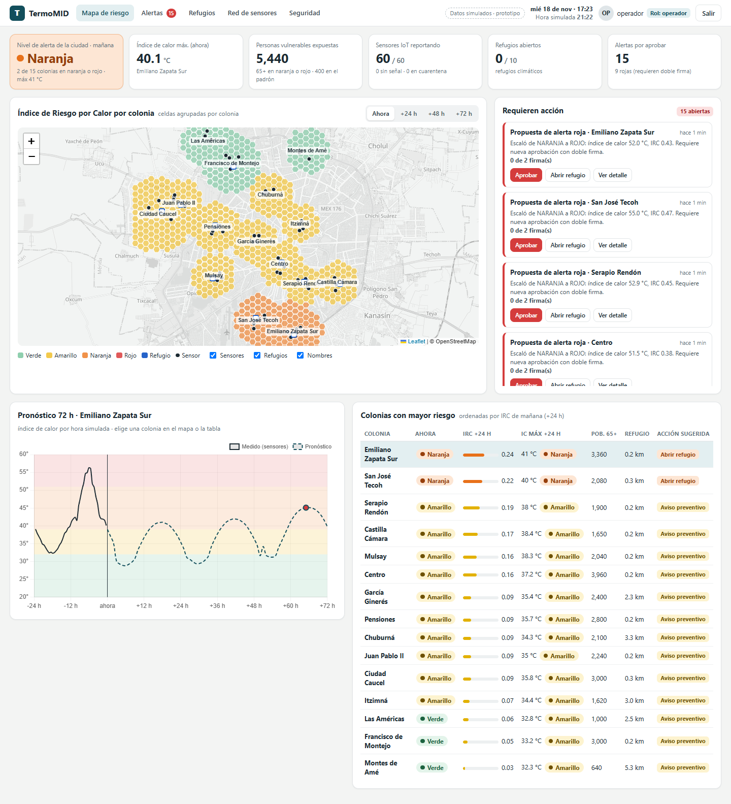

# TermoMID · Alerta temprana por calor extremo, colonia por colonia (Mérida)

Prototipo alfa del proyecto de la materia *Informática en la Cuarta Revolución Industrial*
(Universidad Anáhuac Mérida). **Todos los datos son simulados**: no son mediciones ni registros reales.

TermoMID simula una red IoT de 60 sensores LoRaWAN repartidos en 15 colonias de Mérida.
El backend en la nube ingesta y valida la telemetría, calcula el índice de calor (fórmula de Rothfusz, NWS),
el Índice de Riesgo por Colonia (IRC = Peligro × Vulnerabilidad × (1 − Capacidad)) y un pronóstico a
+24/+48/+72 h. El modelo **propone** alertas y una persona las **aprueba** (la roja con doble firma).
Incluye bitácora de seguridad y reglas de detección tipo SIEM.

| Página | Para quién |
|---|---|
| `/centro` | Centro de mando de Protección Civil (login: operador / supervisor) |
| `/ciudadano` | App ciudadana pública para celular (español y maya) |
| `/demo` | Controles de la exposición (protegidos con contraseña) |
| `/docs` | Documentación interactiva de la API |



## Correr en local (Windows)

```powershell
py -3.13 -m venv .venv
.\.venv\Scripts\Activate.ps1
pip install -r requirements.txt
copy .env.example .env      # y cambia TODOS los valores
uvicorn app.main:app --reload
```

Abre http://127.0.0.1:8000/centro. Sin `DATABASE_URL` se usa SQLite (`termomid.db`).
Para probar el gateway externo: `python simulador.py` (o `--url https://...` contra la nube).

## Desplegar en Render

El archivo [`render.yaml`](render.yaml) es un *Blueprint*: crea el servicio web y la base PostgreSQL
en el plan gratuito y **genera al azar** todas las contraseñas y llaves (nunca están en el repositorio).
En Render: *New → Blueprint →* elegir este repositorio *→ Apply*. Los secretos se ven en
*termomid → Environment*.

## ¿Por qué Render y no Azure para el prototipo?

El pitch propone **Azure (región México Central)** para producción. Para el prototipo usamos **Render**
porque es igualmente **PaaS** (no administramos servidores ni sistema operativo: subimos código y la
plataforma lo construye, lo ejecuta, le pone HTTPS y lo vigila), tiene plan gratuito sin tarjeta y se
configura con un solo archivo versionado (`render.yaml`).

| | Prototipo (Render) | Producción (Azure) |
|---|---|---|
| Aplicación | Render Web Service (Python) | Azure App Service (Linux, Python) |
| Base de datos | Render PostgreSQL (gratuita, vence a los 30 días) | Azure Database for PostgreSQL – Flexible Server |
| Secretos | Variables de entorno generadas por el Blueprint | Azure Key Vault + identidad administrada |
| Región | Virginia (EE. UU.) | México Central (datos en territorio nacional) |
| Disponibilidad | Se duerme tras 15 min sin tráfico | Siempre encendido, con SLA y escalado |

**Cómo se migraría** (el código no cambia, solo la configuración):
1. Crear un *Azure Database for PostgreSQL – Flexible Server* en México Central y copiar su cadena de conexión.
2. Crear un *App Service* (Linux, Python 3.13) y conectarlo al repositorio de GitHub (GitHub Actions).
3. Comando de inicio: `uvicorn app.main:app --host 0.0.0.0 --port 8000 --no-proxy-headers`.
4. Cargar las variables de entorno (`DATABASE_URL`, `SECRET_KEY`, `SENSOR_MASTER_KEY`, contraseñas,
   `CONFIAR_PROXY=true`) como referencias a Azure Key Vault.
5. Agregar lo que en el prototipo se simula: certificados X.509 por sensor (Azure IoT Hub / DPS),
   MFA con Microsoft Entra ID y envío al SIEM (Microsoft Sentinel).

---
Proyecto académico. Los textos en maya son una traducción de apoyo que debe validar un hablante nativo.
